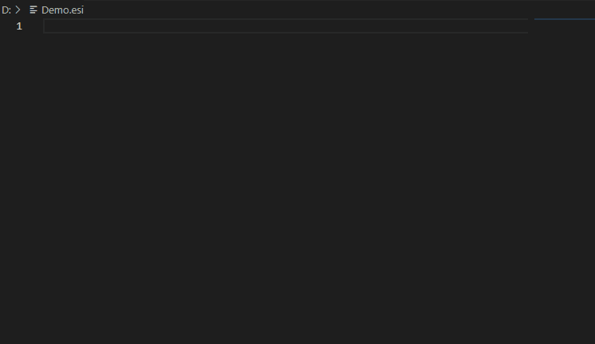
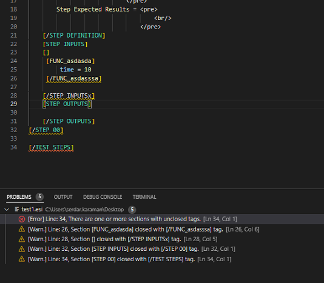

<h1 align="center">esi Helper for TestPit</h1>

<p align="center">
  <em>Syntax highlighting, validation, IntelliSense, and refactoring for TestPit <code>.esi</code> test scripts.</em>
</p>

<p align="center">
  <a href="https://marketplace.visualstudio.com/items?itemName=karamandev.esi-helper-for-testpit"></a>
  <a href="https://marketplace.visualstudio.com/items?itemName=karamandev.esi-helper-for-testpit"></a>
  <a href="https://marketplace.visualstudio.com/items?itemName=karamandev.esi-helper-for-testpit"></a>
  <a href="https://marketplace.visualstudio.com/items?itemName=karamandev.esi-helper-for-testpit&ssr=false#review-details"></a>
  <a href="https://github.com/Mavrikant/esi-Helper-for-TestPit/actions/workflows/ci.yaml"></a>
  <a href="https://github.com/Mavrikant/esi-Helper-for-TestPit/releases"></a>
  <a href="https://github.com/Mavrikant/esi-Helper-for-TestPit/blob/main/LICENSE"></a>
  <a href="https://github.com/Mavrikant/esi-Helper-for-TestPit"></a>
</p>

---

**esi Helper for TestPit** turns VS Code into a first-class editor for TestPit test scripts. It validates scripts as you type, highlights unknown identifiers, autocompletes connections / fields / enums from your project's TestPit XML configs, and formats `.esi` files with bus-aware indentation — so you spend less time chasing typos and more time writing tests.

<p align="center">
  
</p>

<p align="center">
  
</p>

## Highlights

- **Live validity check** against the configured `TestPit.exe` — errors surface in the Problems panel (source `TestPit`) shortly after you stop typing, and again for every open `.esi` file after a profile switch or Reload TestPit Settings. The check waits for a short pause (0.6 s by default, `esihelper.liveValidationDelay`; `esihelper.liveValidation` turns it off) and runs one TestPit process per file at a time, so typing stays smooth and the panel always ends up reflecting the final text.
- **Outline, breadcrumbs and Go to Symbol** (`Ctrl+Shift+O`) built from the section tags: TEST STEPS → STEP → STEP INPUTS / OUTPUTS → message blocks, each with its own icon. A step shows its `Step Description` beside its name. Keeps working on half-written scripts with unclosed or mismatched tags.
- **Tag-based folding** — every multi-line section folds on its `[NAME]`…`[/NAME]` tags rather than on indentation, `<pre>…</pre>` bodies fold, and runs of `#` comment lines fold as comments.
- **Component IntelliSense** for `429_…`, `1553_…`, `DIS_…`, `Mem_…`, `VORILS<N>_…`, `PART_<partition>_<port>`, and `ED_…` (External Data) tags. Connections, fields, enum values, and `%VARIABLE%` references are completed and hover-documented from the active profile's TestPit XML configs. Re-indexes automatically when the XMLs change.
- **`%MACRO%` navigation** — Go to Definition (`F12`), Find All References (`Shift+F12`), Rename (`F2`), occurrence highlighting, hover (value and where it is defined) and completion after `%` for `%NAME%` variables. A definition is a `%NAME% = value` line — in `[VARIABLES]` or any other section — or one handed to an included file in an `[INCLUDE]` block; definitions and uses in files reached through `include file = …` are found too. Needs no profile.
- **Macro checks** (no profile needed): a macro no definition was found for is a warning, an unused `[VARIABLES]` macro is faded, a name that differs from a definition only by case is a hint — with quick fixes "Change to '%NAME%'" and "Remove unused variable". They run only on a complete script (one with `[TEST STEPS]` / `[TEST DEFINITION]`) whose includes could all be read, so an include fragment is never flagged. The macros TestPit fills in itself (`%TARGETIP%`, `%FUNCTARGETIP%`, `%PARTITIONPORTNUMBER%`, `%FUNCTIONPORTNUMBER%`, `%REPORTDIR%`, `%SYSTEMTIME%`, `%SYNCTIME%`) and `%TIMEOUT%` are never reported as undefined.
- **Go to Definition into the TestPit config XML** — `F12` / `Ctrl+click` on a component tag, a field name or an enum value opens its `<Connection>` / `<Port>`, `<Message>`, `<Field>` or `<Enum>` in the active profile's config files (both config formats, shared `<Common>` definitions included). Hover cards carry an "Open definition" link.
- **Matching tags** — with the cursor on `[NAME]` or `[/NAME]` both tags are highlighted; editing one name edits the other (`editor.linkedEditing`, on by default for `.esi`); **Go to Matching Tag** (`Ctrl+Shift+\`) jumps between them, or from inside a block to its opening tag.
- **Clickable file references** — `Ctrl+click` opens the file named by a `file.csv line:N col:M` reference (at that cell), an `include file` / `result file` value, or any other path-shaped value. Paths resolve relative to the script's folder; a link appears only when the file exists.
- **CSV cells:** `field = file.csv line:N col:M` reads the referenced cell (a real CSV reader: quoted fields, embedded commas and line breaks, CRLF, BOM) and validates it against the field's enum table, or against `MinValue`/`MaxValue` for a numeric field. Hovering the reference shows the cell's value, its column header and row, or says whether the file, line or column is missing.
- **Step-number checks** — a step number used twice is a warning, a number lower than the previous step's is an information hint; both offer the quick fix **Renumber steps**.
- **Enum value validation** by name **or number** — `SDI = INSTALLATION_NUMBER_ONE` and `SDI = 1` are both accepted, while an out-of-table value is flagged (matching TestPit's resolver). Macros/CSV/file references are skipped.
- **Structural & conformance checks** (need no profile — they run even before you pick one): unbalanced/mismatched section tags; duplicate keys within a message block; A708 messages, `MANUAL_VERIFY`/`EXTERNAL_VERIFY`, or output-only fields (`occurrence`/`synchronize`/`match`) placed under `[STEP INPUTS]`; out-of-grammar `occurrence`/`match` values; and numeric values outside a field's `MinValue`/`MaxValue`. These mirror TestPit's own validator and are deliberately skipped for `%macro%`/CSV/include-sourced values, so they never false-positive. The tag reader matches TestPit's own, including the one-liner `[NAME/]` form and the sloppy shapes it repairs (`[[NAME]]`, `[//NAME]`, `[NAME] junk`, `[NAME`).
- **Rich, theme-aware syntax highlighting** — distinct colours for step tags (`[STEP n]`), structural section tags, component tags, the slash of `[/NAME]` / `[NAME/]`, message fields, keys, enum values, `%MACRO%` references, file/folder paths, quoted strings, numbers, units glued to numbers (`10ms`, `400Hz`), the `<` / `>` of an `occurrence` count, `<pre>` / `<br/>` markup, the `line:N col:M` part of a CSV reference, constants and comments. The built-in light themes (Light 2026, Light Modern, Light+, Visual Studio Light, Quiet Light, Solarized Light, High Contrast Light) get their own palette at WCAG AA contrast (≥ 4.5:1); other themes get the dark/default palette. Reserved / unused fields (per the XML config) are struck through, and components, fields and enum values the loaded config does not know are shown in italics. Semantic highlighting is switched on for `.esi` only. Setting your own `editor.tokenColorCustomizations` / `editor.semanticTokenColorCustomizations` replaces the extension's defaults wholesale; to recolour for one theme (or to give a third-party light theme the light palette) use a `"[Theme Name]"` block.
- **Auto-formatting** with ESI-aware indentation **and `=` alignment**: `[TAG]…[/TAG]` contents indent in 4-space steps; field assignments in a section align their `=` to one column (`esihelper.alignmentScope` = `section` or `tier`), including `<pre>` openers whose bodies stay under the aligned `<pre>`. Runs via **Format Document** (`Shift+Alt+F`) or on save (`esihelper.refactorDocumentOnSave`); tabs → 4 spaces on every save. **Format Selection** (`Ctrl+K Ctrl+F`) formats only the selected lines, exactly as Format Document would (depth, alignment and `<pre>` anchoring are computed from the whole file), so a partly selected alignment group stays uneven until the rest is formatted too. Formatting applies small per-line edits, so the cursor, selections and folded regions survive it.
- **Tag completion** — after `[` the structural sections (`VARIABLES`, `TEST STEPS`, `STEP`, `STEP INPUTS`, …) are offered alongside the profile's connections, the ones that belong at the cursor first; accepting one on an empty line also writes the matching `[/NAME]` below, correctly indented. After `[/` the sections still open are listed, innermost first. Structural names need no profile.
- **Quick fixes** (`Ctrl+.`) for the extension's own diagnostics: change an unknown component or field to the closest known name (a component's closing tag is renamed with it), pick an enum value (closest first), set an out-of-range value to the minimum or maximum, correct a `match` / `occurrence` value, remove a duplicate key or an output-only field under `[STEP INPUTS]`, add a missing `[/NAME]` or correct a mismatched one — plus "Fix all … in this file" for duplicate keys, output-only fields and out-of-range values.
- **Multi-profile support driven by TestPit's own settings:** profiles and their config files are read from the Windows registry (`HKCU\Software\ESEN\TestPit`). The status-bar item (bottom-right) shows the active profile; click to switch via QuickPick.
- **Section completion with bodies** — after `[`, each section inserts its usual lines (`[STEP DEFINITION]`, `[TEST DEFINITION]`, `[VARIABLES]`, `[CMD_EXECUTE]`, `[MANUAL_VERIFY]`, `[EXTERNAL_VERIFY]`, `[STEP GET_DUMP]`), `[STEP` proposes the next step number in the script's own numbering (10, 20 → 30; zero padding kept) as a tab stop mirrored into the closing tag, and "STEP (full skeleton)" inserts a complete step. Bodies are inserted only for a brand-new tag on an empty line. Snippets remain for `[FUNC_*]` and `[PART_*]`.
- **Smarter field and value completion** — on an empty line inside `[STEP INPUTS]` / `[STEP OUTPUTS]` each known connection has a second entry "<name> (with fields)" that inserts the block with `time` and up to 8 non-reserved fields as aligned tab stops. Field names already assigned in the block are no longer offered, reserved fields are listed last, and `occurrence` / `match` / `synchronize` are not offered under `[STEP INPUTS]`. After a field's `=`, the `.csv` files next to the script (or in the folder typed so far) are offered and insert `file.csv line:1 col:1`.
- **Inlay hints** inside component blocks — after a numeric value on an enum field the enum's name is shown (`SDI = 1` shows `INSTALLATION_NUMBER_ONE`); after a numeric value on a field with a declared unit, the unit (`Course = 100.0` shows `deg`); optionally the declared `[min..max]` range. Taken from the active profile's XML configs only; nothing is shown for `%macro%` values, CSV cell references, parameter keys, unknown or reserved fields, or definition blocks. See the `esihelper.inlayHints.*` settings.
- **Keyword hover** — hover a TestPit parameter key inside a message block (`match`, `occurrence`, `synchronize`, `time`, …) or a structural section tag (`[STEP INPUTS]`, `[VARIABLES]`, `[STEP DUMP/]`, `[STEP <id>]`, …) for a short card: the accepted values of `match` / `occurrence`, which parameters are output-only, where a section belongs and what is not valid inside it. Needs no profile. Parameters whose behaviour the extension has no source for show only their class (common / bus-specific / output-only) — it does not guess at their meaning.
- **Step renumbering** (sequential 10, 20, 30, …; structure-aware — each closing tag takes its own opening tag's number, and only the digits are edited) and a **Go to Step picker** (`Ctrl+G`) that lists every step with its description — type a number or a word to filter, move through the list to preview, Enter to jump, Escape to go back.
- **Open with TestPit** — launches the active script in the configured `TestPit.exe`.
- **CodeLens** — at the top of a root script (one with `[TEST STEPS]` or `[TEST DEFINITION]`): **Validate** and **Open with TestPit**. Above every `[STEP n]`: a summary such as `2 inputs · 1 output` (the blocks directly inside its `[STEP INPUTS]` / `[STEP OUTPUTS]`; click to fold or unfold the step), and, when the step has problems, `2 errors, 1 warning` (click to jump to the problem, or pick from a list). Turn off with `esihelper.codeLens.enabled`.
- **Validation status in the status bar** — next to the profile item, for the active `.esi` editor: a spinner while `TestPit.exe` checks the file, otherwise the error and warning counts reported for it (all sources). Click opens the Problems panel. The counts are always numbers, never a "passed" mark; the tooltip says when the TestPit part is missing (no executable set) or may be out of date (live check off).
- **TestPit Components view** (Explorer side bar) — everything the active profile's config files define, as bus → connection → fields, each field with its type, range, step, unit and number of enum values. Click a connection to insert its `[NAME]` … `[/NAME]` block at the cursor of the active `.esi` editor (the same block `[`-completion writes), click a field to insert `field = `. A line that already has text is never changed — the insertion goes on a new line below. Filter by words (connection, message, field and enum-value names), and right-click → **Go to XML Definition**. Follows profile switches, Reload TestPit Settings and config-file edits.
- **Validate All .esi Files in Workspace** — runs the extension's in-process checks (structure, step numbering, macros, components / fields / enums / CSV cells against the active profile) over every `.esi` file, without opening editors, and lists the findings in the Problems panel with a summary and a per-file report in the output channel. It does **not** run `TestPit.exe` and is not a substitute for TestPit's validity check. Files that could not be read are reported as "NOT CHECKED", never as clean.
- **Test Explorer** — every `.esi` script in the workspace appears in the Testing view with its `[STEP …]` blocks as children. The one run profile, **Validate (TestPit validity check)**, runs the same `TestPit.exe --validateScriptOnly` check as Run Validity Check. **The test is not executed:** green means TestPit reported no error for that script or step in the validity check, and says nothing about the result on hardware. A step is red when TestPit reports an error on a line inside it; warnings are listed in the output but do not turn an item red; a script TestPit produced no validation log for is shown as errored, never passed.
- **Menus and a walkthrough** — Run Validity Check and Open with TestPit as editor title-bar buttons; Go to Step, Update Step Numbers, Refactor Document and Run Validity Check in the editor right-click menu; Open with TestPit on a `.esi` file in the Explorer. "Get started with esi Helper for TestPit" (Help → Welcome → Walkthroughs) covers first-run setup.

## Getting started

1. Install the extension from the [VS Code Marketplace](https://marketplace.visualstudio.com/items?itemName=karamandev.esi-helper-for-testpit).
2. Open any `.esi` file. On first use you're prompted to **pick your `TestPit.exe`** (the console build, used for validation) — or run **ESI Helper: Pick TestPit Executable** any time.
3. The status bar (bottom-right) shows the active **TestPit profile**, read from TestPit's own registry settings. Click it to switch profiles, or run **ESI Helper: Reload TestPit Settings** after you change config paths in the TestPit GUI.

## How configuration works

The extension reads the profiles and their config-file paths straight from **TestPit's Windows registry settings** at `HKEY_CURRENT_USER\Software\ESEN\TestPit` — the same settings the TestPit GUI manages. There is nothing to wire up per project:

- `Settings\SettingPrefix` lists the profiles; element `[0]` is the active one.
- Each `<Profile>\Executer\*ConfigFile` value supplies a config path by **role** (`ConfigFile`→cable, `A429ConfigFile`, `1553ConfigFile`, `DiscreteConfigFile`, `PartitionConfigFile`, `VORILSConfigFile`, `EDConfigFile`); element `[0]` is the live file.

On first use this is exported once and cached in the extension's global storage; switching profiles reads the cache, and **Reload TestPit Settings** re-exports it. The `TestPit.exe` path is **not** in the registry, so it's picked once via a dialog and remembered.

**Both configuration formats are read.** TestPit v1.3.6.19 introduced a second shape for the message configuration files — one attribute per value instead of one child element, `Version="2"` on the root, and the states that repeat across a file defined once under `<Common><CommonEnums>` and taken by `Ref`. Files in either shape index identically, so there is nothing to change either way, and a converted and unconverted project behave the same. Note that **Run Validity Check** hands the script to your configured `TestPit.exe`: a format 2 configuration needs TestPit v1.3.6.19 or newer, and an older executable will report one as unreadable even though the editor reads it fine.

### Settings

The two formatting settings are **user-scoped (machine-wide)** — they live in your VS Code _User_ settings, never in `.vscode/settings.json`. The `esihelper.inlayHints.*` settings can be set per user or per workspace.

| Setting | Purpose |
|---|---|
| `esihelper.refactorDocumentOnSave` | When `true`, runs the full ESI formatter (re-indent + `=` alignment) on save. (Tabs → 4 spaces happens on every save regardless.) |
| `esihelper.alignmentScope` | `section` (default) aligns `=` within each block; `tier` aligns all blocks at the same bracket-depth together. |
| `esihelper.inlayHints.enumNames` | Default `true`. Show the enum name after a numeric value on a field that has an enum table. |
| `esihelper.inlayHints.units` | Default `true`. Show the unit the XML config declares after a numeric field value. |
| `esihelper.inlayHints.ranges` | Default `false`. Show the declared `[MinValue..MaxValue]` after a numeric field value. |
| `esihelper.liveValidation` | Default `true`. Run the TestPit validity check automatically while you edit. When `false`, TestPit is only run on demand (Run Validity Check, CodeLens, Test Explorer); the extension's in-process checks keep running. |
| `esihelper.liveValidationDelay` | Default `600`. Quiet period in milliseconds after the last edit before the live check starts `TestPit.exe`. Clamped to 200–10000. |
| `esihelper.codeLens.enabled` | Default `true`. Show the CodeLens lines in `.esi` files. VS Code's own `editor.codeLens` also applies. |

VS Code's own `editor.inlayHints.enabled` is the master switch for the hints.

The extension also turns on the built-in `editor.linkedEditing` for `.esi` files, so renaming an opening tag renames its closing tag. To switch that off, add `"[esi]": { "editor.linkedEditing": false }` to your settings.

## Commands

| Command | What it does | Keybinding |
|---|---|---|
| ESI Helper: Run Validity Check | Validate the current `.esi` (or, from an editor title button / context menu, the file it was invoked on) against the active profile (`TestPit.exe --validateScriptOnly`) without blocking the editor. The full TestPit output goes to the output channel, the issues to the Problems panel, and a short summary ("n errors, n warnings" / "clean") is shown at the end. | — |
| ESI Helper: Open with TestPit | Open the current script (or the `.esi` file right-clicked in the Explorer) in the TestPit **GUI** (`TestPitw.exe`, derived from the configured executable's folder). | — |
| ESI Helper: Update Step Numbers | Renumber `[STEP N]` blocks sequentially (10, 20, 30, …) and report what changed. Non-numeric steps (`[STEP GET_DUMP]`, `[STEP %N%]`) are left alone; step numbers written in prose or in `Step Dependencies` are not updated. | — |
| ESI Helper: Refactor Document | Trim trailing whitespace and convert tabs to 4 spaces. | — |
| ESI Helper: Show Processed File | Open TestPit's last preprocessed script (`Documents\Testpit\Preprocessed.esi`) side‑by‑side. | — |
| ESI Helper: Select TestPit Profile | Switch the active profile (from the registry's `SettingPrefix`); also offers "Change TestPit executable…". | — |
| ESI Helper: Reload TestPit Settings | Re-read profiles & config-file paths from the registry — run this after adding a profile or changing config paths in the TestPit GUI. | — |
| ESI Helper: Pick TestPit Executable | Choose / re-point the console `TestPit.exe` used for validation. | — |
| ESI Helper: Show Component Validation Info | Diagnostic dump: active profile, resolved config files, index size, and the current component‑validation issues. | — |
| ESI Helper: Go to Step | Step picker: lists every `[STEP N]` with its Step Description (and Requirements). Type a number or text to filter; highlighting previews, Enter jumps, Escape returns. | `Ctrl+G` (when editing `.esi`) |
| ESI Helper: Go to Matching Tag | Jump from `[NAME]` to its `[/NAME]` and back; from a line inside a block, to the opening tag of the innermost enclosing section. | `Ctrl+Shift+\` (when editing `.esi`; replaces the built-in Go to Bracket there) |
| ESI Helper: Validate All .esi Files in Workspace | Run the in-process checks on every `.esi` file in the workspace (respecting `files.exclude`); results go to the Problems panel, a per-file report to the output channel. Cancellable; partial results are kept. Does not run `TestPit.exe`. | — |
| ESI Helper: Clear Workspace Validation Results | Remove the results of the workspace run from the Problems panel. They are also cleared when the profile, the registry settings or a config XML changes. | — |
| ESI Helper: Filter Components… | Narrow the TestPit Components view; several words must all match. | — |
| ESI Helper: Clear Component Filter | Show all components again (available while a filter is active). | — |
| Insert Component at Cursor / Go to XML Definition | Context-menu actions of the TestPit Components view (not in the Command Palette). | — |
| Go to Definition / Peek (built-in) | On a `%MACRO%`: its definition. On a component tag, field or enum value: its element in the TestPit config XML. | `F12` / `Ctrl+click` |
| Find All References / Rename (built-in) | For `%MACRO%` variables. Rename is limited to the current file and is refused when an included file uses the name or could not be read. | `Shift+F12` / `F2` |
| Go to Symbol in Editor (built-in) | Jump to any section of the script; the same tree feeds the Outline view and breadcrumbs. | `Ctrl+Shift+O` |
| Quick Fix (built-in) | Fixes for the extension's own diagnostics (see Highlights). | `Ctrl+.` |
| Format Document (built-in) | ESI‑aware indentation **+ `=` alignment**. | `Shift+Alt+F` (when editing `.esi`) |
| Format Selection (built-in) | The same formatting for the selected lines only; lines outside the selection are not touched. | `Ctrl+K Ctrl+F` |

## Development

```bash
npm install
npm run compile     # tsc → out/
npm run lint        # ESLint (flat config)
npm test            # mocha unit tests
npm run coverage    # c8 coverage report
npm run test:integration   # extension-host suite (downloads VS Code; not part of npm test)
```

`npm run test:integration` opens fixture `.esi` files in a real VS Code instance (downloaded by `@vscode/test-electron` into `.vscode-test/`) and checks document symbols, folding, completion, diagnostics, code actions and formatting through the public API. It needs no `TestPit.exe` and no registry; on headless Linux run `xvfb-run -a npm run test:integration`. `VSCODE_TEST_VERSION` selects the VS Code version (default: stable).

The extension activates when the workspace contains a `.esi` file, a `.esi` file is opened, one of its commands is run, or its walkthrough or view is opened — not at every VS Code start.

Press `F5` in VS Code to launch the Extension Development Host. CI runs lint + compile + test on Ubuntu / macOS / Windows × Node 22 for every push to `main` and every PR.

See [CLAUDE.md](CLAUDE.md) for an architecture overview and contribution conventions, and [CHANGELOG.md](CHANGELOG.md) for release history.

## Author

**M. Serdar Karaman** — [GitHub](https://github.com/Mavrikant) · [LinkedIn](https://www.linkedin.com/in/mserdarkaraman/) · [karaman.dev](https://karaman.dev/)

## License

Licensed under the [GNU General Public License v3.0](LICENSE).

Copyright © 2020 M. Serdar Karaman
